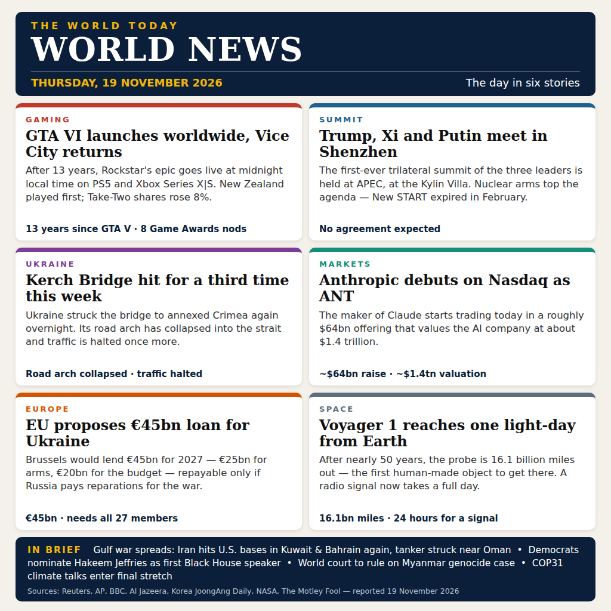

# 19 November 2026 — World News in One Image

[](https://make.fun/bounty/news-image-20261119/leaderboard?utm_source=github&utm_medium=readme&utm_campaign=news-image-20261119)
[](https://make.fun/bounty/news-image-20261119?utm_source=github&utm_medium=readme&utm_campaign=news-image-20261119)
[](https://make.fun/bounty/news-image-20261119?utm_source=github&utm_medium=readme&utm_campaign=news-image-20261119)

One 1024&times;1024 infographic summing up the world news of **19 November 2026**,
built for the [make.fun news-image-20261119 competition](https://make.fun/bounty/news-image-20261119?utm_source=github&utm_medium=readme&utm_campaign=news-image-20261119)
($250 pot, top 50 paid).

The layout leads with the six biggest stories of the day — a game launch, a
bridge strike, a three-way summit, a funding proposal, a space milestone and a
record IPO — and closes with an **IN BRIEF** strip of the day's other headlines.
Every story below was checked against same-day reporting before it was drawn,
including the Anthropic IPO figure ($81.3bn at $83 a share, 980 million shares).



## The six stories

1. **GTA VI is out.** Rockstar's Grand Theft Auto VI launches worldwide on 19 November
   after a 13-year wait, scoring 99/100 on Metacritic from 147 reviews; fans
   celebrate in Miami and Dublin.
2. **Kerch Bridge hit for the third time in a week.** Ukraine strikes the bridge
   linking annexed Crimea to Russia again on 19 November; a 227-metre section of
   roadway collapsed in the earlier strikes and traffic is halted.
3. **Trump, Xi and Putin meet in Shenzhen.** The leaders of the United States, China
   and Russia hold their first three-way summit on the sidelines of the APEC forum.
4. **EU proposes a &euro;45bn loan for Ukraine.** Europe puts forward a &euro;45 billion
   loan to keep Ukraine funded as the three leaders meet in Shenzhen.
5. **Voyager 1 reaches one light-day from Earth.** NASA's probe, launched in 1977,
   becomes the first human-made object to travel a full light-day from Earth, still
   sending data from interstellar space.
6. **Anthropic's record $81.3bn IPO.** The Claude maker prices its IPO at $83 a
   share — the largest stock-market debut on record — and starts trading on the
   Nasdaq on 19 November under the ticker ANT.

The image also carries an **IN BRIEF** strip with the day's other headlines.

## How it works

`main.py` copies `assets/entry.png` to `/output/entry.png` and verifies the copy
byte-for-byte with SHA-256, so the output is deterministic:

```bash
python3 main.py
# copied assets/entry.png -> /output/entry.png
# sha256: <digest of the image>
```

No network access is needed at run time. Python 3 only, standard library only.

## Preview

Open `index.html` in a browser to see the image together with the story list.
